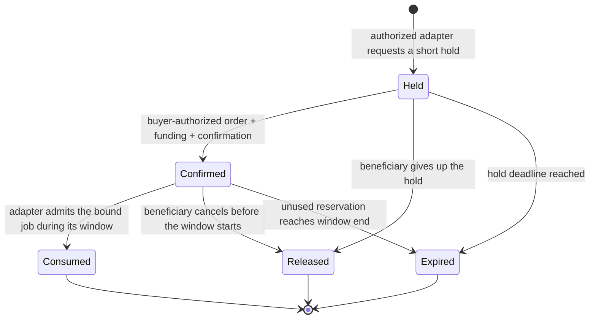

# Service Capacity Reservations

Author: Ted (@haot3x)
Date: 2026-10-23; integration update: 2026-10-26
Status: Local prototype implemented; no ERC number assigned; not submitted

Implementation: [README.md](./README.md). Validation: [RESULTS.md](./RESULTS.md). The chosen baseline uses ERC-1155 custodial inventory and receipt IDs plus ERC-2135 consumption; additional booking and order semantics remain experimental application code.

Standards-review update: [APPROVED-STANDARDS-REVIEW.md](./APPROVED-STANDARDS-REVIEW.md) checks Final standards separately from merged drafts and open PRs. ERC-1155, ERC-2135, and ERC-5006 substantially overlap the initial idea. The product experiment remains useful, but independent ERC novelty is unproven. The review supersedes any implication below that inventory limits or one-time consumption are new primitives.

ASF integration update: [ASF-INTEGRATION.md](./ASF-INTEGRATION.md) describes an optional guarded market using pinned reference registries. Guarded pools use one adapter and one immutable safety binding; the original two-market baseline remains available. Suspension closes new commitments, a narrow essential-only policy permits already-admitted result submission, and original escrow recovery/settlement retains independent authority. This is a local consumer profile, not evidence of a new ERC requirement.

## Problem and first use case

A provider offers ten standardized research-report jobs in one daily service window. Finch and a second marketplace sell access to the same pool. If Finch reserves six units, the second marketplace cannot reserve another five while those six remain allocated.

The user selected research reports / audit task slots as the first demonstration. The prototype commits a bounded research-report input/output template in `examples/research-report-v1.json`. Tests exercise admission and payment with mock report results; no report generator or off-chain input validator is implemented. Arbitrary reports or audits are not assumed to require equal resources.

The proposed shared object is a provider-declared quota for admitting work in a specified window. It is not proof of physical compute capacity, actual work, quality, or timely delivery. A delivery deadline and acceptance conditions belong to the referenced service order. Ten admissions in a window does not establish that ten reports finish in that window.

## What would make this a useful ERC?

Different marketplaces and order systems could read and consume the same reservation object without maintaining independent, conflicting stock counts. The potential standard covers the reservation interface, state transitions, authorization requirements, event semantics, and shared accounting invariant.

The six-plus-five inventory example is a prototype sanity check, not evidence of a new standards primitive. Existing token accounting can enforce finite stock. The remaining candidate contribution is consistent booking-state and service-order interpretation across implementations, with existing consumption and rights interfaces reused where appropriate.

No Ethereum consensus change is needed. A deployed EVM contract supplies the authoritative state. An ERC document would make independently implemented contracts and integrations interoperable; assigning a number or merging a document would not itself deploy or enforce anything.

One marketplace using one private database does not demonstrate a need for an ERC. Two local adapters now share one inventory contract, using direct buyer transactions and relayed signed holds respectively. They share an escrow base and are not independent implementations. A later milestone is a second implementation reading the same specification; that milestone remains open.

## Approaches considered

| Approach | Benefit | Cost / limitation | Decision |
|---|---|---|---|
| Central booking API | Smallest product implementation; easiest scheduling changes | Marketplaces trust one operator and its availability; no independently enforceable shared ledger | Useful product baseline |
| Shared on-chain pool and reservation records | Atomic admission and portable state across participating marketplaces | Gas, wallet integration, transaction ordering, and explicit recovery | Proposed prototype |
| Transferable capacity tokens | Could support resale and inventory distribution | Introduces transfer, beneficiary changes, resale policy, and underlying-rights questions before basic booking works | Deferred |

The selected product direction is service reservations. The implementation choices below are recommendations for a prototype, not a finalized ABI or approved formal specification.

## Scope of the first prototype

- One EVM chain and one authoritative registry deployment.
- A provider creates an immutable pool for one service definition and one time window.
- Integer units; a report template defines one unit through a content commitment.
- Fixed quota, provider, service hash, terms hash, window, and adapter set after pool creation.
- Two explicitly authorized marketplace/order adapters share the pool. Their authorization and buyer-consent checks are part of the integration trust boundary.
- Reservations are bound to one beneficiary and one adapter. No resale, splitting, partial consumption, provider substitution, or cross-chain inventory.
- The kernel holds no money. A separate order adapter coordinates escrow and reservation confirmation atomically when both are on the same chain.
- The booking ledger does not decide whether a report is good enough or when money is earned.

## Proposed records

**Pool:** provider, service definition hash, service terms hash, total units, window start/end, maximum hold duration, authorized adapter addresses, held-unit counter, confirmed-unit counter, consumed-unit counter.

**Reservation:** unique reservation ID, pool ID, beneficiary, creating adapter, units, hold expiry, status, and an immutable order reference once confirmed. The order reference includes an order-contract address and order ID. Its chain is the registry's chain.

**Service definition:** exact input/output constraints, unit meaning, and optional version-pinned skill reference. The document remains off-chain; its content hash is on-chain. A mutable download URL is only a retrieval hint. The booking application must retrieve and validate the document before requesting consent.

No source code, prompt, private report, or secret is stored on-chain. A deliverable commitment can be recorded by the order system without exposing the report itself.

Pool creation requires authenticated provider approval of the entire pool definition and adapter set; merely naming a provider address is insufficient. The first prototype uses a direct call by the provider account. Creation rejects a zero provider, zero quota, zero service/terms commitments, an empty adapter set, duplicate or zero adapter addresses, and invalid time parameters. It requires `now < windowStart < windowEnd` and a strictly positive maximum hold duration. Holds are additionally capped at `windowStart`, so the duration cannot authorize late confirmation. An adapter must have deployed code; this check does not establish that its code is trustworthy or immutable.

## Proposed lifecycle

Time is checked at transaction execution using block timestamps, not at signature creation or transaction broadcast. Intervals are half-open: a deadline is no longer valid when `block.timestamp >= deadline`.

### Hold

Only a pool-authorized adapter may create a hold, after verifying a buyer's request. The adapter binds the beneficiary, pool, units, and a unique request identifier. The first prototype rejects replay of that identifier per adapter. Units must be positive, the pool must exist, and the transaction must execute before `windowStart`.

`holdUntil` must be later than the current time, no later than `windowStart`, and no more than the pool's maximum hold duration away. The ledger checks availability and increases held units atomically. Multiple signed offers or cached availability responses are not reservations.

Holds are intentionally restricted to provider-authorized adapters in this prototype. The supplied adapters authenticate buyers but do not implement rate limits, booking fees, or per-buyer quotas. Short expiry and authorization do not prevent repeated inventory squatting by accepted buyers. A production market needs a separate admission and economic policy.

### Confirm and pay

Only the reservation's creating adapter may confirm an unexpired hold. It authenticates buyer consent and binds the reservation to one funded order, then moves units from held to confirmed without changing total occupied quota. An order reference may bind at most one reservation in this prototype.

The adapter must verify that the order identifies the pool's provider, the reservation's beneficiary as the customer receiving service, the exact service and terms commitments, the reserved unit count, and an admission window compatible with the pool. These checks occur again immediately before consumption against authoritative order state. The initial adapter rejects incompatible order amendments; it does not infer that extra payment increases reserved quota. Payer sponsorship may be added later without silently changing the service beneficiary.

The paid adapter performs escrow funding, order creation/binding, and confirmation in one EVM transaction. A revert in any step reverts all effects. The adapter must propagate failure, prevent reentrancy, check actual token movement for its explicitly supported token, and reject ERC-20 `false` returns. A payment on another chain or an earlier standalone transfer does not have this atomicity guarantee.

Confirmation reserves service admission; it does not pay the provider for completed work. Whether a buyer makes a deposit or funds the entire service price is an order-policy choice outside the ledger. The implemented demonstration uses one exact-transfer test token and fully funded escrow. The buyer evaluates submitted results; acceptance pays the provider, rejection refunds, and an unresolved admitted/submitted order is refundable at the immutable settlement deadline. This deliberately simple trust model does not implement arbitration.

### Admit work

Only the reservation's bound adapter may consume a confirmed reservation, and only during `[windowStart, windowEnd)`. The reservation must still reference the same order. The order adapter verifies that the order is eligible for admission and records admission atomically with consumption.

Consumption moves the units from confirmed to permanently consumed for that pool. It represents an authorized job admission, not evidence that an off-chain agent has begun computing. Duplicate consumption reverts. A completed or failed job does not automatically restore its consumed quota.

The off-chain dispatcher checks the admitted order and uses a stable order identifier to prevent duplicate dispatch. This is an application integration requirement; the ledger does not guarantee exactly-once off-chain effects.

### Release and expiry

The beneficiary may release an unexpired hold, or cancel a confirmed reservation before `windowStart`. Relayed release requires buyer authorization checked by the bound adapter. The provider has no unilateral release function for existing confirmed bookings.

Releasing capacity does not itself refund money. The paid integration must expose buyer cancellation through its adapter and coordinate the refund with release in one transaction. If the beneficiary releases directly through the ledger, the order must still expose a recoverable, one-time refund claim based on the terminal reservation state; the implementation must not strand escrow or refund twice. This direct-release recovery case is required before a paid demo is considered complete.

Anyone may explicitly expire a held reservation at or after `holdUntil`, or an unused confirmed reservation at or after `windowEnd`. Each terminal transition updates counters once and retains a tombstone. Contracts do not wake up automatically when time passes; callers or keepers submit the expiry transaction.

Unused confirmed expiry also requires an adapter-owned financial recovery path. For the fully funded prototype, an unconsumed reservation that expires entitles the buyer to a full one-time escrow refund. A caller may trigger expiry and refund together; if a different caller already expired the ledger record, the refund remains claimable separately. Neither `Expired` nor `Released` permits later provider settlement. Refund accounting is terminal and shared across cancellation and expiry paths, preventing duplicate payment. Other fee policies require separately agreed terms and are not part of this first paid demonstration.

Expired-but-not-cleaned reservations remain counted conservatively until cleanup. Read views disclose stored counters, record deadlines, and booking eligibility separately. They must not advertise reclaimed capacity without an executable cleanup path. No unbounded scan is required: cleanup addresses individual reservation IDs; any batch helper must be bounded.

## Accounting invariant

For every pool:

`heldUnits + confirmedUnits + consumedUnits <= totalUnits`

Stored availability is `totalUnits - heldUnits - confirmedUnits - consumedUnits`. Booking eligibility is separate and becomes false at `windowStart`. An expired hold can be reclaimed and rebooked only if the booking window has not closed.

Example: quota ten; marketplace A holds six. Marketplace B's attempt to hold five reverts. B can hold four. Confirming A's six does not free six. Starting those six moves them into consumed quota. Finishing all six does not make six additional daily admissions available.

This guarantee applies only to the same `(chainId, registry, poolId)`. It cannot detect the provider selling the same real-world capacity in a different pool, another chain, another identity, or an unintegrated marketplace. Service identity and a shared pool reference are therefore essential to discovery and integration.

## Interfaces to specify after the prototype

Implemented operations include `createPool`, `hold`, `confirm`, `consume`, `release`, `expire`, `getPool`, `getReservation`, and `availability`. Custom booking names and layouts are experimental application APIs, not a finalized new ERC specification.

The prototype reuses ERC-2135's `consume`, `isConsumableBy`, event, and ERC-165 interface ID. Its asset ID is the reservation receipt ID; the consumer is the beneficiary and consumption data encodes the bound order contract and ID. Pool and receipt units remain in registry custody. Hold converts available pool units into receipt units, cancellation converts unused receipts back, and consumption permanently burns receipts. Tests check the actual ERC-1155 burn and ERC-2135 event. See README.md for the full representation and permission boundary.

Transitions emit events linked through reservation identity. Read views remain authoritative; a cached event index is not permission to reserve or execute. Unknown record getters revert. ERC-2135's eligibility query instead returns false for an unknown or ineligible asset.

## Composition and prior art

Research checked on 2026-10-23. This is a proposed standardization gap, not a claim that capacity reservation is a new invention or that nobody has discussed it. Search coverage is limited; an empty title search is not proof of novelty.

| Source | Relevant coverage | Potential distinction to validate | Raw URL |
|---|---|---|---|
| ERC-5006 | Quantity-bearing, expiring user rights over ERC-1155 assets | Booking phases, one-time work admission, order binding, and permanently consumed per-window quota may require additional semantics; first test whether an extension suffices | https://eips.ethereum.org/EIPS/eip-5006 |
| ERC-4907 | NFT user role and expiry | Useful rights precedent; does not by itself specify this booking lifecycle | https://eips.ethereum.org/EIPS/eip-4907 |
| ERC-8183 | Funded jobs, evaluation, payment/refund | Can supply the order and payment lifecycle; reservation is an earlier provider-side admission constraint | https://eips.ethereum.org/EIPS/eip-8183 |
| ERC-8414 | Task tenders, submissions, reward-slot and escrow protection | Its submission reservations are demand-side reward commitments; this proposal concerns shared provider-side admission quota before work | https://ethereum-magicians.org/t/erc-8414-token-bound-task-tenders/29597 |
| ERC-8409 | Signed service payment quotes | Quotes can describe a purchase, but signing several quotes does not allocate shared inventory | https://ethereum-magicians.org/t/erc-8409-signed-service-payment-quotes/29577 |
| ERC-8448 proposal | Bilateral service-order changes | Potential later adapter; changing order size must not silently create more reserved capacity | https://github.com/ethereum/ERCs/pull/2082 |
| EigenDA payment specification | Period-specific reserved bandwidth, usage enforcement | Existing domain-specific reservation precedent; not evidence for novelty of reservation itself | https://layr-labs.github.io/eigenda/protocol/payments/payment_system.html |
| ECIR compute marketplace documentation | Describes capacity reservation during a compute-job lifecycle | Existing marketplace precedent; deployment and implementation claims were not independently verified | https://www.ecirlabs.com/docs/compute-marketplace |
| EIP-1 | ERC classification and focused interoperability standards | Supports an application standard, with a demonstrated need across applications | https://eips.ethereum.org/EIPS/eip-1 |

The 8183/8414 adapters are proposed integration targets, not completed integrations. Their exact lifecycle compatibility must be checked before claiming support. Existing kernel contracts must not be assumed to expose a reservation callback.

## Implemented test coverage

1. Two distinct marketplace adapters share ten units; six plus five fails, six plus four succeeds.
2. Competing transactions for the last unit admit at most one reservation.
3. Confirmation preserves occupied quota; consumption never makes that quota available again.
4. Expired holds cannot confirm; explicit expiry releases exactly once; a stale UI cannot bypass checks.
5. Unauthorized adapters, substituted beneficiaries, replayed requests, and duplicate order bindings fail.
6. Cancellation boundaries and consume/expiry boundaries have deterministic outcomes at exact timestamps.
7. Successful report completion or a work failure cannot remint the day's consumed quota.
8. Escrow funding failure or confirmation failure leaves neither payment nor confirmed booking behind.
9. Direct ledger release remains recoverable through the refund path; repeated claims cannot pay twice.
10. A failed order-admission update rolls back reservation consumption.
11. Unused confirmed expiry permits a one-time refund both with atomic cleanup and after third-party cleanup; no provider settlement remains possible.
12. A reservation cannot admit a different provider, beneficiary, service, terms commitment, or unit count, including after an incompatible order amendment.
13. Pool provider is the creating caller; invalid windows, zero quotas, invalid adapter sets, and unauthorized price configuration fail.

Local code and executable tests now cover these cases. The two adapters use mock orders and share escrow code. Deployment, independent market adoption, and public discussion remain subsequent work. RESULTS.md records the actual test run and its limitations.

## Design review

An independent document review identified three gaps: unused confirmed-expiry refunds, order/reservation compatibility checks, and authenticated pool creation. The design now specifies each and adds corresponding test requirements. A second review confirmed all three findings resolved at the exploratory-design level. This is a design review, not a contract audit or evidence that a prototype passes tests.

## Delivery sequence and decision gates

1. Completed locally: ERC-1155 inventory plus ERC-2135 consumption and two booking entry points, with accounting and transaction-order tests.
2. Completed locally: a shared test-token escrow with atomic funding, cancellation, expiry recovery, and work-result settlement. No real funds or production order integration are involved.
3. Validate a genuinely independent order integration and compare its custom-rule requirements against the alternatives analyzed in APPROVED-STANDARDS-REVIEW.md. ERC-5006 and a non-token baseline remain unimplemented. Distinguish Final dependencies from draft targets. If composition covers the useful behavior, ship the application or a narrow profile.
4. Prepare one short Ethereum Magicians discussion with the concrete six-plus-five counterexample, reference code, and a focused question about the interoperability boundary.
5. Publish a formal draft only after checking for duplicate work and receiving implementation-level feedback. Public authorship: Ted (@haot3x). No number is self-assigned.

Reference code and tests are published at https://github.com/haot3x/service-capacity-reservations. The pinned GitHub Actions workflow runs the local checks on push. Deployment and independent adoption remain separate milestones.

## Open questions

- Do providers actually need to sell the same pool through multiple marketplaces? Finch plus a second adapter proves the mechanism, not market adoption.
- Which exact report template is homogeneous enough to represent one unit? Who accepts input eligibility?
- Can authorized short holds provide acceptable availability without a booking fee, or is an anti-squatting policy needed?
- Does a reservation need cancellation fees or resale later? Both would change the economic terms and should be versioned extensions.
- Will a second marketplace use a common ledger and an independent implementation, rather than only a shared frontend?

## Why this direction was selected

The user selected service-capacity reservations because it could become a concrete market product, then chose research reports / audit task slots as the first example. The design therefore concentrates on a testable admission quota and existing order settlement, with broader scheduling and transferable capacity deferred.
